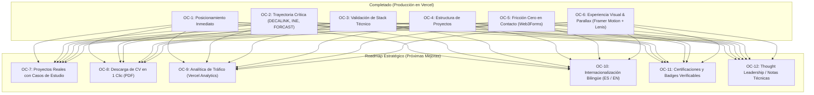

# Plan ODD (Outcome-Driven Development): Portafolio Profesional
**Esteban Andrés Rojas Rojas** — Ingeniero Civil en Computación & Full-Stack Developer

---

## 1. Visión y Enfoque ODD (Outcome-Driven Development)
El enfoque **ODD** orienta cada etapa de desarrollo hacia **Resultados Clave (Outcomes)** enfocados en el reclutador técnico, líder de ingeniería o cliente empresarial que visita el portafolio.



---

## 2. Estado de Resultados Clave (Fases 1 y 2 — Completadas)

| Resultado Clave (Outcome) | Estado | Módulo / Entregable | Impacto Logrado |
| :--- | :---: | :--- | :--- |
| **OC-1: Posicionamiento e Impacto Inmediato** | **COMPLETADO** | Hero Section + Typewriter dinámico | Comunica el perfil en < 3s, nombre animado, badges clave y estado de disponibilidad en tiempo real. |
| **OC-2: Credibilidad por Trayectoria Crítica** | **COMPLETADO** | Timeline de Experiencia Laboral | Detalle de DECALINK, INE (Censo Digital) y FORCAST con filtros interactivos por rol. |
| **OC-3: Validación de Stack Técnico** | **COMPLETADO** | Matriz de Habilidades Categorizada | Stack principal destacado (Java, Spring Boot, Angular, PostgreSQL, Docker) y filtros por área. |
| **OC-4: Muestra Modular de Proyectos** | **COMPLETADO** | Sección de Proyectos (Proyecto 1, 2, 3) | Estructura modular con links y tags de tecnologías, lista para recibir casos reales. |
| **OC-5: Fricción Cero en Contacto** | **COMPLETADO** | Sección de Contacto + Integración Web3Forms | Mensajes recibidos en tiempo real en `earojasr96@gmail.com` + enlaces directos a WhatsApp y LinkedIn. |
| **OC-6: Cinemática & Parallax** | **COMPLETADO** | Framer Motion + Lenis Smooth Scroll | Scroll cinemático a 60 FPS, barra de progreso superior y micro-físicas de interacción. |
| **OC-Infra: CI/CD y Git Flow** | **COMPLETADO** | Repositorio GitHub + Vercel | Separación de ramas (`main` para producción, `develop` para nuevas features). |

---

## 3. Hoja de Ruta de Mejoras Futuras (Fase 3 & Backlog Estratégico)

A continuación se detallan las mejoras de alto impacto identificadas para seguir elevando el perfil profesional:

### 🚀 OC-7: Reemplazo de Proyectos por Casos de Estudio Reales
- **Objetivo**: Demostrar resolución de problemas complejos con métricas cuantificables.
- **Acciones**:
  1. Reemplazar los textos *Lorem Ipsum* de `Proyecto 1, 2 y 3` por proyectos reales (personales, open source o empresariales sanitizados).
  2. Estructurar cada tarjeta con el framework **Problema → Solución Arquitectónica → Impacto/Métricas** (ej. *"Reducción de latencia en un 35% mediante optimización de Stored Procedures"*).
  3. Añadir mini-capturas de pantalla reales o diagramas de arquitectura.

### 📄 OC-8: Descarga Directa del CV en 1 Clic (PDF)
- **Objetivo**: Reducir a cero la fricción para reclutadores que necesitan compartir el perfil en comités de contratación.
- **Acciones**:
  1. Alojar el PDF actualizado del CV en `public/cv-esteban-rojas.pdf`.
  2. Añadir botón con icono de descarga en el Navbar y en el Hero.

### 📊 OC-9: Analítica Privada de Reclutadores (Vercel Web Analytics)
- **Objetivo**: Conocer qué empresas y reclutadores visitan el portafolio sin comprometer la privacidad (sin cookies).
- **Acciones**:
  1. Habilitar Vercel Web Analytics en 1 clic en el dashboard de Vercel.
  2. Medir visitas, países de origen, secciones más leídas y clics en el botón de contacto/LinkedIn.

### 🌐 OC-10: Internacionalización Bilingüe (Español / English)
- **Objetivo**: Abrir el mercado a ofertas remotas internacionales (EE.UU., Canadá, Europa) donde los salarios en USD para Full-Stack Developers con Java/Angular/React son de alta demanda.
- **Acciones**:
  1. Crear un selector de idioma `ES | EN` en la barra de navegación.
  2. Mapear los textos del CV al inglés en `portfolioData.ts`.

### 🎖️ OC-11: Certificaciones y Badges Verificables
- **Objetivo**: Validar competencias formalmente reconocidas por la industria.
- **Acciones**:
  1. Añadir una subsección en Educación con certificaciones (Oracle Certified, Spring Professional, AWS Certified Cloud Practitioner, Scrum Master, ISTQB QA, etc.).
  2. Enlaces directos a credenciales verificables (Credly, Coursera, etc.).

### ✍️ OC-12: Thought Leadership / Notas Técnicas
- **Objetivo**: Posicionarse como un Ingeniero con opinión técnica y criterio arquitectónico sólido.
- **Acciones**:
  1. Pequeño carrusel o listado de 2 o 3 artículos o notas técnicas breves (ej: *"Patrones de indexación en Oracle PL/SQL para procesamiento batch"*, *"Estrategia de aseguramiento de calidad en aplicaciones censales a gran escala"*).
  2. Enlaces hacia LinkedIn Pulse o Medium.

### 🌓 OC-13: Alternador de Tema (Light / Dark Mode Toggle)
- **Objetivo**: Accesibilidad y preferencia visual del evaluador.
- **Acciones**:
  1. Interruptor sol/luna en el Navbar usando Tailwind dark mode.

---

## 4. Guía de Ejecución de Nuevos Cambios

Todo nuevo desarrollo seguirá el estándar establecido:
```bash
# 1. Trabajo en rama 'develop'
git checkout develop

# 2. Implementación de cambios y pruebas locales
npm run dev

# 3. Verificación de calidad
npm run lint && npm run build

# 4. Pase a producción (Merge a 'main')
git checkout main && git merge develop && git push origin main && git checkout develop
```
